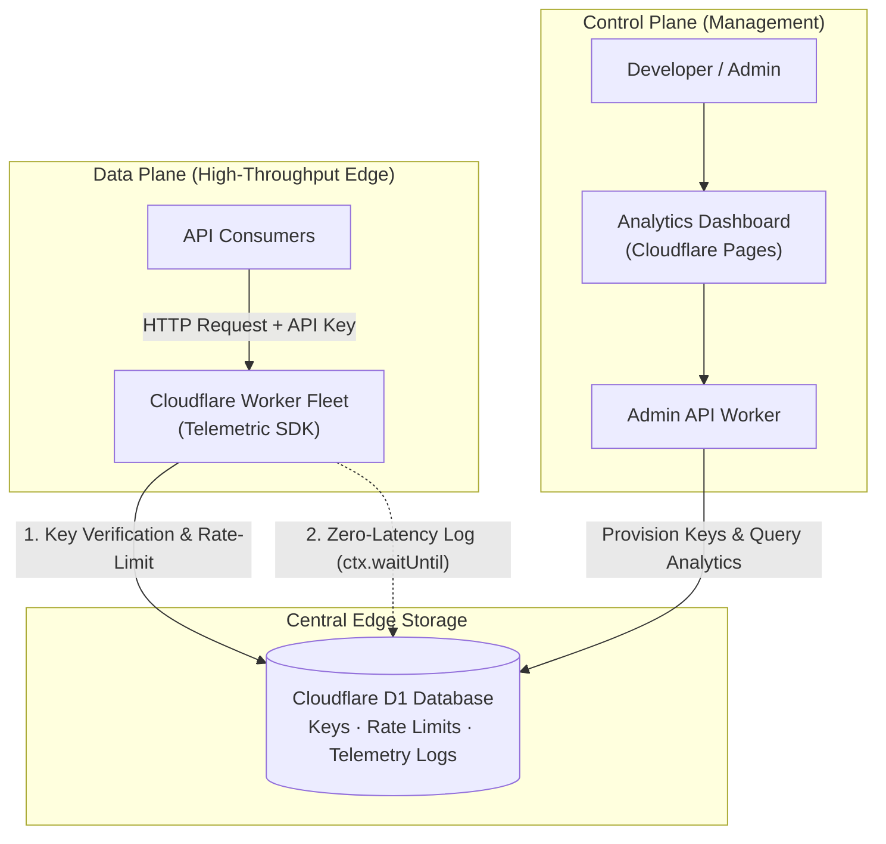

# Telemetric

> Self-hosted API key gateway, rate limiter, and zero-latency observability platform for Cloudflare Workers.

[](https://workers.cloudflare.com/)
[](https://developers.cloudflare.com/d1/)
[](https://react.dev/)
[](https://tailwindcss.com/)
[](LICENSE)

**Telemetric** gives you centralized API keys, edge rate-limiting, and request logging across your Cloudflare Workers without paying for external SaaS aggregators or adding latency to your endpoints.

Everything runs inside your own Cloudflare account on **Cloudflare D1** (serverless SQLite at the edge).

[Live Demo Dashboard](https://apimonitor-dashboard.pages.dev) • [Quickstart](#quickstart) • [Architecture](#architecture)

---

## 30-Second Integration

Drop the portable middleware into any existing Cloudflare Worker:

```javascript
import { ApiMonitor } from "./monitor.js";

export default {
  async fetch(request, env, ctx) {
    const startTime = Date.now();
    const monitor = new ApiMonitor("my-service", env, ctx);

    // 1. Authenticate with D1 & enforce rate limits
    const auth = await monitor.authenticate(request);
    if (!auth.ok) {
      monitor.log(request, auth.status, Date.now() - startTime, null, auth.error);
      return new Response(JSON.stringify({ error: auth.error }), { status: auth.status });
    }

    // 2. Run your worker's core business logic
    const response = await handleRequest(request);

    // 3. Log telemetry asynchronously (adds 0ms to response latency)
    monitor.log(request, response, Date.now() - startTime, auth.keyData);
    return response;
  }
};
```

---

## Why Telemetric?

Most API monitoring and key management tools either:
- **Add response latency** by waiting for logs to write to an external database before returning the HTTP response.
- **Cost money** through third-party SaaS vendors (Datadog, Axiom, BetterStack) once your request volume scales.
- **Require external infrastructure** (Redis clusters, Kafka pipelines, managed Postgres).

Telemetric solves this at the edge:
1. **0ms Added Latency**: Uses Cloudflare's `ctx.waitUntil()` lifecycle hook. The client gets their response immediately; telemetry flushes to D1 in the background.
2. **Runs on Cloudflare Free Tier**: 100,000 requests/day, 5M database reads/month, and 10GB storage at $0.
3. **Fail-Open by Design**: If D1 is ever unreachable or rate-limited, logging gracefully degrades so your production APIs never fail.

---

## What's Included

- **Zero-Latency Telemetry**: Records response status codes, execution duration (ms), client IPs, geolocation, endpoints, and key metadata without slowing down client requests.
- **SHA-256 Hashed Keys**: Raw keys are generated client-side, salted, and stored exclusively as SHA-256 digests. Plaintext keys are never stored in queries or the database.
- **Granular Key Scopes**: Restrict tokens to specific microservices (`auth_*`, `media_*`, `webhook_*`) or issue global (`all`) fleet keys with customizable expiration windows.
- **Edge Rate Limiting**: Per-minute sliding bucket counters stored directly in D1 enforce rate limits (`429 Too Many Requests`). Expired buckets are pruned automatically.
- **Interactive Key Tester & Playground**: Built-in HTTP workbench that tests endpoints directly in the browser, featuring automatic prefix-mismatch detection to switch target services in one click.
- **Self-Hosted Management Dashboard**: Clean, responsive UI built with React 19 and Tailwind CSS featuring dark/light modes, live log filtering, and key CRUD.

---

## Architecture



---

## Quickstart

Deploy your complete Telemetric stack on Cloudflare in under 5 minutes:

### 1. Clone & Install
```bash
git clone https://github.com/saahiyo/Telemetric-apimonitor.git
cd Telemetric-apimonitor
```

### 2. Create the D1 Database
```bash
# Authenticate with Cloudflare
npx wrangler login

# Create your D1 instance
npx wrangler d1 create apimonitor-db
```
*Copy the `database_id` output from Wrangler.*

### 3. Initialize the Schema
```bash
npx wrangler d1 execute apimonitor-db --remote --file=./schema.sql
```

### 4. Deploy the Backend Worker
1. Copy the example configuration:
   ```bash
   cp backend/wrangler.toml.example backend/wrangler.toml
   ```
2. Paste your `database_id` and set an `ADMIN_KEY` passcode inside `backend/wrangler.toml`.
3. Deploy to Cloudflare Workers:
   ```bash
   npm run deploy:backend
   ```
*Copy your deployed Worker URL (e.g. `https://apimonitor-server.<your-subdomain>.workers.dev`).*

### 5. Launch the Dashboard
```bash
cd frontend
cp .env.example .env
```
Set `VITE_API_BASE` in `frontend/.env` to your backend URL from Step 4.

```bash
# Run locally:
npm install
npm run dev

# Or deploy to Cloudflare Pages:
npm run build
npx wrangler pages deploy dist --project-name apimonitor-dashboard --branch main
```

---

## Security

- **Cryptographic Hashing**: API keys are hashed with Web Crypto (`SHA-256`) before D1 insertion. Compromising database read access does not reveal raw client secrets.
- **Admin Isolation**: Administrative endpoints (metrics querying, key generation, revocation) require `x-admin-key` header verification.
- **Fail-Open Telemetry**: If a database write encounters edge throttling, telemetry logging catches the exception and exits silently to protect consumer uptime.

---

## License

MIT © [Shakir Ansari](https://github.com/saahiyo)
