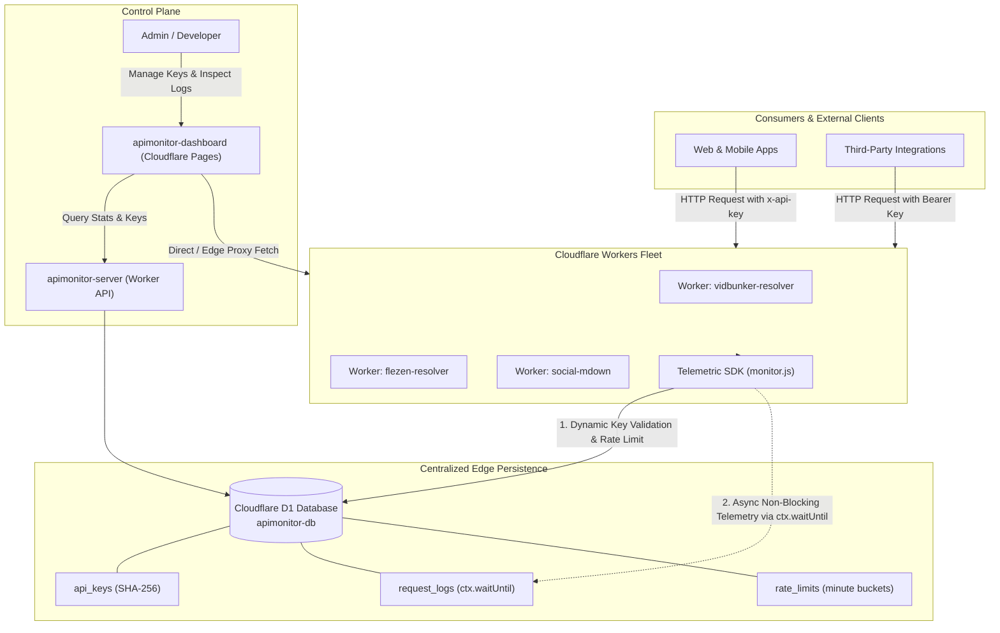

# ⚡ Telemetric

> **Edge-Native API Observability, Dynamic Auth & Fleet Gateway for Cloudflare Workers.**

[](https://workers.cloudflare.com/)
[](https://developers.cloudflare.com/d1/)
[](https://react.dev/)
[](https://tailwindcss.com/)
[](LICENSE)

**Telemetric** is a centralized observability and API management platform built specifically for Cloudflare Workers. It provides dynamic API key authentication, per-minute edge rate limiting, and zero-latency asynchronous telemetry logging across multi-worker fleets — all backed by Cloudflare D1 (serverless SQLite at the edge) and an Apple-inspired desktop management dashboard.

🔗 **Live Production Dashboard**: [https://apimonitor-dashboard.pages.dev](https://apimonitor-dashboard.pages.dev)

---

## 🏛 Architecture



---

## ✨ Key Features

### 1. 🚀 Zero-Latency Telemetry via `ctx.waitUntil()`
Traditional API gateways introduce response latency while logging transactions. Telemetric leverages Cloudflare’s `ctx.waitUntil()` lifecycle hook to record status codes, duration (ms), client IPs, geolocation, endpoints, and key metadata in the background **after** the client response has already completed.

### 2. 🔑 Dynamic Edge API Key Management
- **SHA-256 Hashing**: Raw secret keys are hashed with Web Crypto before storage; plain secrets are never exposed in queries.
- **Fleet & Service Scoping**: Restrict keys to individual workers (e.g., `vb_` for VidBunker, `flz_` for Flezen, `smd_` for Social Media Downloader) or issue global (`all`) tokens.
- **Expirations & Instant Revocation**: Set 7-day, 30-day, 1-year, or custom validity windows. Revoke keys instantly with one click.

### 3. 🛡️ Per-Minute Edge Rate-Limiting
Atomic minute-bucket counters stored directly in Cloudflare D1 enforce rate limits (`HTTP 429 Too Many Requests`). Historical rate-limit windows are automatically purged asynchronously to keep storage footprint minimal.

### 4. 🧪 Built-in API Playground & Edge Key Tester
- **Cloudflare 1042 Loop-Bypass**: Solves Cloudflare's edge limitation preventing same-account worker-to-worker subrequests through intelligent dual-mode direct client routing and edge proxy fallback.
- **Proactive Key Detection**: If a developer tests a `vb_*` key against a `social-mdown` endpoint, the tester detects the prefix mismatch and offers a 1-click test switch.

### 5. 🎨 Apple Human Interface Design Foundation
- Clean, focused admin UI built with fluid typography, translucent acrylic backgrounds (`backdrop-blur`), and subtle border hierarchies.
- **Multiple Theme Accents**: Choose between Linear Violet, Ocean Blue, Emerald Green, and Warm Amber.
- **Dark & Light Modes**: High-contrast, meticulously calibrated color tokens with zero eye strain.
- **Haptic Audio Feedback**: Tactile interaction sounds generated dynamically via the browser Web Audio API (with instant mute toggle).

---

## 📁 Repository Structure

```text
├── backend/                  # Cloudflare Worker API server (Admin API & D1 queries)
│   ├── src/index.js          # REST endpoints for stats, key CRUD, and logs
│   ├── wrangler.toml         # Cloudflare Worker deployment configuration
│   └── wrangler.toml.example # Sanitized template configuration
├── frontend/                 # Management Dashboard (React 19, Vite, Tailwind CSS)
│   ├── src/                  # App components, theme state, audio engine
│   ├── .env.example          # Environment variable template
│   └── vite.config.js        # Vite bundler configuration
├── sdk/                      # Portable Worker Middleware SDK
│   ├── monitor.js            # ApiMonitor middleware class
│   └── README.md             # SDK standalone integration guide
├── schema.sql                # Production D1 SQLite schema (tables, indexes)
└── package.json              # Monorepo convenience scripts
```

---

## 🚀 Quickstart & Self-Hosting

Deploy your own complete Telemetric stack on Cloudflare's **free tier** in under 10 minutes.

### Prerequisites
- Node.js 20+
- A [Cloudflare](https://dash.cloudflare.com/) account
- Cloudflare Wrangler CLI (`npm install -g wrangler`)

### Step 1: Clone the repository
```bash
git clone https://github.com/saahiyo/Telemetric-apimonitor.git
cd Telemetric-apimonitor
```

### Step 2: Create your Cloudflare D1 Database
```bash
# 1. Login to Cloudflare
npx wrangler login

# 2. Create the D1 database
npx wrangler d1 create apimonitor-db
```
*Note down the `database_id` output by Wrangler.*

### Step 3: Initialize the Database Schema
Execute the schema against your remote D1 database:
```bash
npx wrangler d1 execute apimonitor-db --remote --file=./schema.sql
```

### Step 4: Configure & Deploy the Backend Worker
1. Copy the example configuration in `backend/`:
   ```bash
   cp backend/wrangler.toml.example backend/wrangler.toml
   ```
2. Open `backend/wrangler.toml` and fill in:
   - `database_id`: Your D1 database ID from Step 2.
   - `ADMIN_KEY`: Your secret administrative passcode.
3. Deploy the backend worker:
   ```bash
   npm run deploy:backend
   ```
*Copy the deployed worker URL (e.g., `https://apimonitor-server.<your-subdomain>.workers.dev`).*

### Step 5: Configure & Launch the Dashboard
1. Set up the frontend environment variable:
   ```bash
   cd frontend
   cp .env.example .env
   ```
   Add your deployed backend URL to `frontend/.env`:
   ```env
   VITE_API_BASE=https://apimonitor-server.<your-subdomain>.workers.dev
   ```
2. Run locally or deploy to Cloudflare Pages:
   ```bash
   # Local development:
   npm install
   npm run dev

   # Deploy to Cloudflare Pages:
   npm run build
   npx wrangler pages deploy dist --project-name apimonitor-dashboard --branch main
   ```

---

## 🔌 Integrating the SDK into Any Cloudflare Worker

Connecting any worker in your fleet to Telemetric takes just **3 lines of code**:

```javascript
import { ApiMonitor } from "./monitor.js";

export default {
  async fetch(request, env, ctx) {
    const startTime = Date.now();
    const monitor = new ApiMonitor("my-service-name", env, ctx);

    // 1. Authenticate with D1 dynamic keys & rate limits
    const auth = await monitor.authenticate(request);
    if (!auth.ok) {
      monitor.log(request, auth.status, Date.now() - startTime, null, auth.error);
      return new Response(JSON.stringify({ error: auth.error }), { status: auth.status });
    }

    // 2. Perform your API task
    const response = await handleRequest(request);

    // 3. Asynchronously record telemetry without adding latency
    monitor.log(request, response, Date.now() - startTime, auth.keyData);
    return response;
  }
};
```

---

## 🔒 Security Architecture

- **Zero Plaintext Key Storage**: API keys are generated with `crypto.getRandomValues()`, salted by service scope prefix, and stored exclusively as SHA-256 digests.
- **Fail-Open Safeguards**: In the event of temporary D1 rate-limiting or network partition, the SDK fails open on analytics logging to guarantee customer-facing APIs experience zero downtime.
- **Admin Access Isolation**: Administrative API endpoints are strictly guarded by `x-admin-key` bearer token verification.

---

## 📄 License

This project is licensed under the [MIT License](LICENSE).

---

Developed by **[Shakir Ansari](https://github.com/saahiyo)** — Open for collaborations and contributions!
